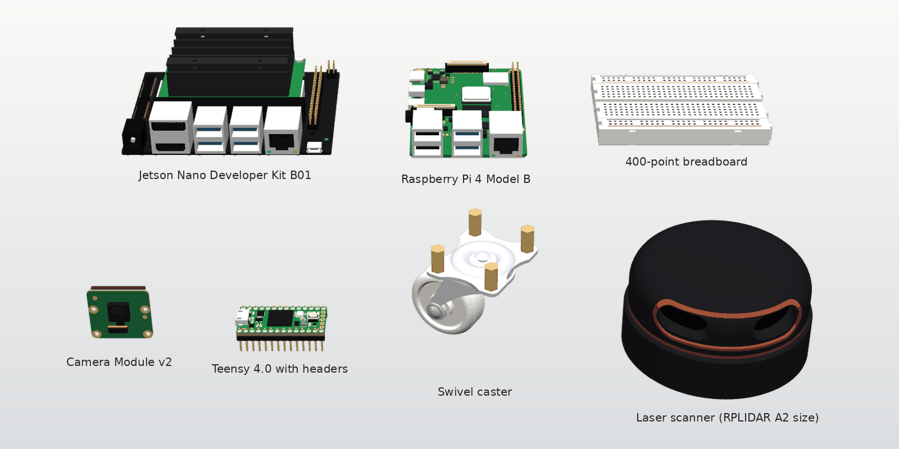
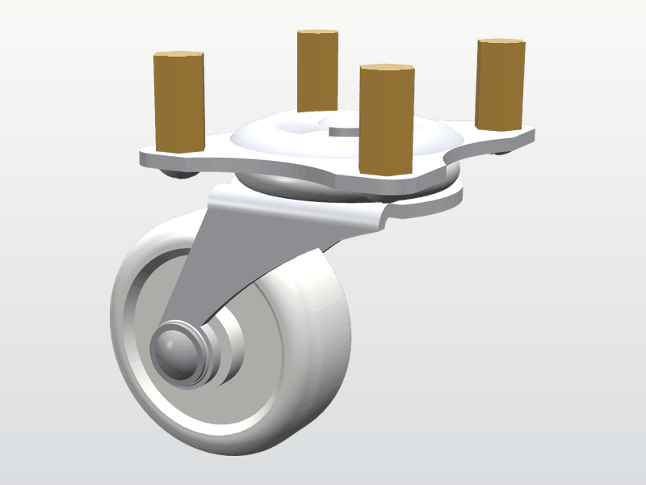
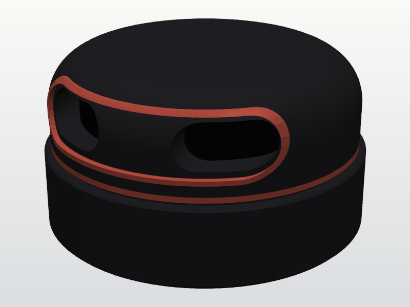
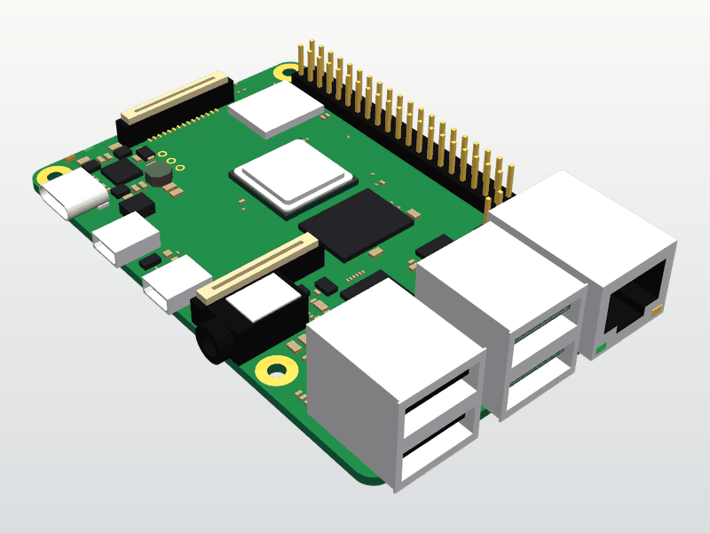
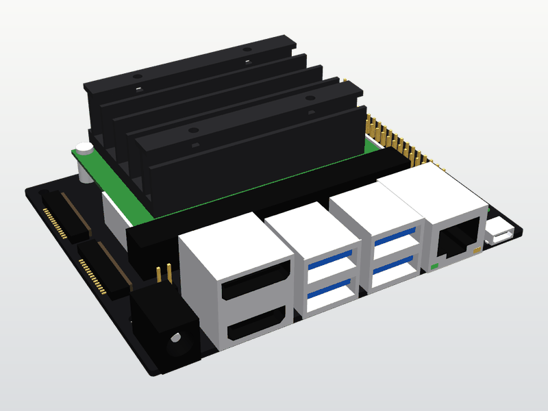
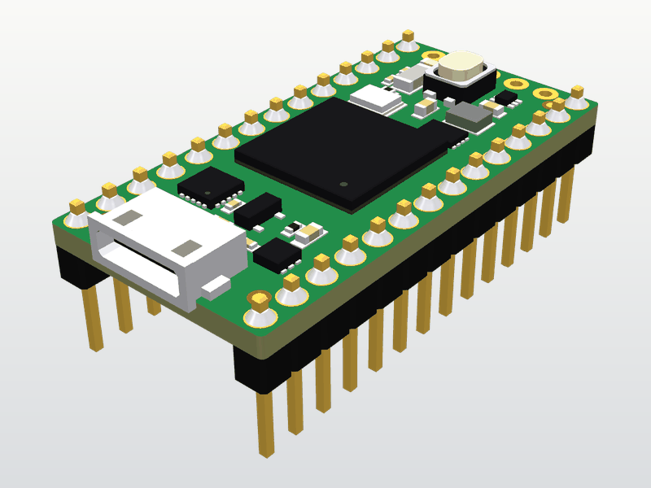
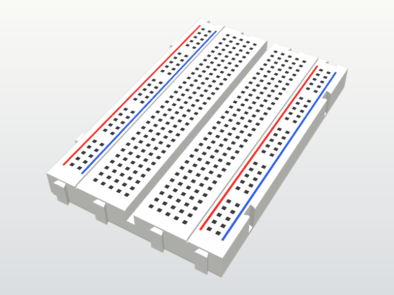
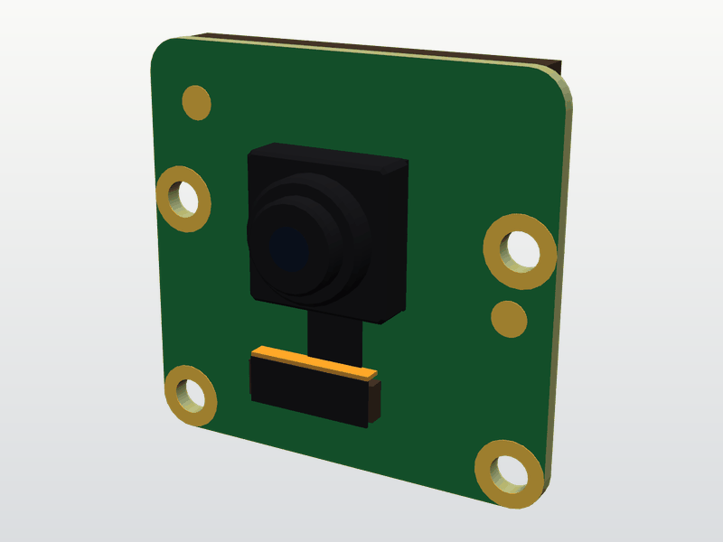

# robot_component_models

Display models of off-the-shelf robot components, such as a laser scanner, single-board computers and a caster, for ROS 1 (Noetic) and ROS 2 (Humble and later). The [DiffBot and Remo](https://ros-mobile-robots.com) robot descriptions use them. Every model was created independently, from public datasheets, drawings and photos. The CadQuery generator and the sources of every model are in this repository, under the [license](#license) below.



These are display models for visualisation in RViz, Gazebo and web viewers. They aren't manufacturing designs. Robot assembly, joints, collision shapes and inertias belong in each robot's description package.

## Parts

| Part | Picture | Meshes | Used by | Triangles | STL / DAE / GLB |
|---|---|---|---|---|---|
| [Swivel caster with a 30 mm wheel](provenance/caster.md) |  | `caster/caster_base`<br>`caster/caster_wheel_support`<br>`caster/caster_wheel` | DiffBot | 9,820<br>6,592<br>5,572 | 491 / 498 / 232 kB<br>330 / 336 / 153 kB<br>279 / 272 / 121 kB |
| [360 degree laser scanner, RPLIDAR A2 size](provenance/rplidar_a2.md) |  | `rplidar_a2/rplidar-a2` | DiffBot, Remo | 13,014 | 651 / 718 / 332 kB |
| [Raspberry Pi 4 Model B](provenance/raspberry_pi_4b.md) |  | `raspberry_pi_4b/raspberry_pi_4B` | Remo | 15,116 | 756 / 1,001 / 594 kB |
| [Jetson Nano Developer Kit B01](provenance/jetson_nano_dev_kit_b01.md) |  | `jetson_nano_dev_kit_b01/jetson_nano_dev_kit_b01` | Remo | 5,696 | 285 / 396 / 252 kB |
| [Teensy 4.0 with two 14-pin headers](provenance/teensy_4_0.md) |  | `teensy_4_0/teensy_4-0` | Remo | 25,520 | 1,276 / 1,650 / 900 kB |
| [400-point solderless breadboard](provenance/breadboard_400_point.md) |  | `breadboard_400_point/breadboard_400_point` | Remo | 6,768 | 338 / 428 / 290 kB |
| [Raspberry Pi Camera Module v2](provenance/raspi_cam_v2.md) |  | `raspi_cam_v2/raspi_cam_v2_IMX219` | Remo | 2,976 | 149 / 209 / 117 kB |
| Wheel 65 × 25 mm | Planned | `wheel/…` | DiffBot, Remo | | |

Each mesh comes in three files in `meshes/<part>/`:

- `<name>.stl`: binary STL in **millimetres**, without colours.
- `<name>.dae`: COLLADA 1.4.1 in **metres**, Z up, with coloured materials and one node per sub-part.
- `<name>.glb`: binary glTF 2.0 in **metres** with the same materials, for web viewers. Each sub-part, such as a connector, is a named node, so a viewer can move the sub-parts apart. The vertex data are in the same Z-up frame as the other files. The root node turns them into glTF's Y up.

[`meshes/manifest.yaml`](meshes/manifest.yaml) lists every file with its checksum, size, units, frame, bounding box, triangle count, sub-parts and materials. The provenance page of each part, linked in the table, lists its sources, what was estimated or simplified, and which measurements would improve it.

## Using the meshes in a URDF

Refer to the files with `package://robot_component_models/meshes/...`. The STL files are in millimetres, so they need a scale of 0.001:

```xml
<visual>
  <geometry>
    <mesh filename="package://robot_component_models/meshes/rplidar_a2/rplidar-a2.stl"
          scale="0.001 0.001 0.001"/>
  </geometry>
  <material name="dark_grey"/>
</visual>
```

The COLLADA files are in metres and bring their own colours. Leave out the scale, and leave out the visual's `<material>` and the link's Gazebo `<material>`: RViz and Gazebo would paint the whole mesh in that one colour.

```xml
<visual>
  <geometry>
    <mesh filename="package://robot_component_models/meshes/rplidar_a2/rplidar-a2.dae"/>
  </geometry>
</visual>
```

Each mesh's frame, its origin and axes, is described in the manifest and on the part's provenance page. The frames are the frames of the meshes DiffBot and Remo used before, so their joint origins stay as they are.

## Adding the package to a workspace

The package installs only data: `meshes/` with the manifest, and the license. It builds with catkin under ROS 1 and with ament_cmake under ROS 2. CadQuery isn't needed to build or use it.

Declare the dependency in the package that uses the meshes:

```xml
<exec_depend>robot_component_models</exec_depend>
```

Then clone a release into the workspace. For example, with [vcstool](https://github.com/dirk-thomas/vcstool), add this to the workspace's `.repos` file and pin a release tag:

```yaml
repositories:
  robot_component_models:
    type: git
    url: https://github.com/ros-mobile-robots/robot_component_models.git
    version: 1.0.0
```

```bash
cd ~/catkin_ws && vcs import src < my_robot.repos
catkin build                      # ROS 1 Noetic
# or, in a ROS 2 workspace:
colcon build --packages-up-to robot_component_models
```

`vcs import --skip-existing` doesn't move an existing checkout to a new tag. To update one, run `git fetch --tags && git checkout <tag>` in `src/robot_component_models`.

## File names and frames

A released file keeps its geometry's frame, units and attachment points. A geometry change that moves the origin, turns the axes, changes the units or moves an attachment point, such as mounting holes or an axle, gets a **new file name**. The old file stays, so robots that use it don't change. A change that keeps all of these, such as a corrected colour or a finer detail, keeps the file name and changes the checksum in the manifest.

The version follows [Semantic Versioning](https://semver.org): the first number rises when a file is removed or renamed, the second when files are added or changed, the third for fixes that leave the meshes as they are.

## Regenerating the meshes

The generators are Python scripts with CadQuery, one per part, in [`generators/`](generators/). Each has its parameters at the top, with the source of each value. [`generators/mesh_export.py`](generators/mesh_export.py) writes the three file formats for all of them.

The meshes are reproducible byte for byte in the pinned environment of [`generators/requirements.txt`](generators/requirements.txt): Python 3.12.3 on Ubuntu 24.04 (glibc 2.39), as in CI. From the repository's root:

```bash
python3 -m venv .venv && .venv/bin/pip install -r generators/requirements.txt
.venv/bin/python -m generators              # write all meshes and meshes/manifest.yaml
.venv/bin/python -m generators --check      # regenerate into a temporary folder and compare
.venv/bin/python scripts/check_meshes.py    # check the files against the manifest
.venv/bin/python scripts/render_parts.py    # render the pictures in docs/images/
```

Other versions of CadQuery, OCP or NumPy, or another operating system, can triangulate differently. The meshes are then still valid, but their checksums change.

## Checks

[CI](.github/workflows/ci.yml) runs on every pull request:

1. **Regeneration**: regenerates all parts twice in the pinned environment and fails if any file differs from the manifest's checksum.
2. **Mesh checks**: every STL is closed and consistently oriented. Triangle counts, units and bounding boxes match the manifest. The COLLADA files are valid against the COLLADA 1.4.1 schema and load in pycollada. The glTF files load in trimesh and pass the Khronos glTF Validator.
3. **ROS packages**: builds and installs the package in the `ros:noetic` and `ros:humble` containers and checks that the installed `share/robot_component_models` holds exactly the manifest's files, the manifest, the license and the build tools' own files.
4. **Code style**: flake8 with ROS 2's ament_flake8 settings and mypy on the generators and scripts.

## Contributing

Corrections from measurements of the real parts are welcome. See [CONTRIBUTING.md](CONTRIBUTING.md).

## License

[BSD 3-Clause License](LICENSE), Copyright (c) 2026, ROS Mobile Robots. The meshes, the generators, the scripts and the documentation are all under this license. Product names such as Raspberry Pi, Jetson, Teensy and RPLIDAR identify the products these models show. They are trademarks of their owners, and the models carry no logos or brand marks.
