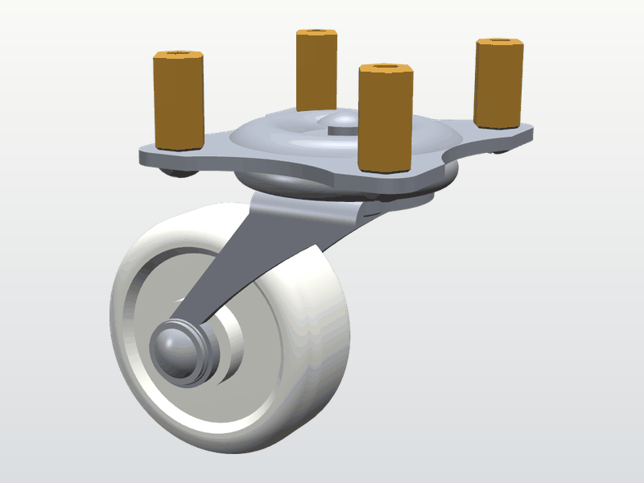

<!-- SPDX-FileCopyrightText: 2026 ROS Mobile Robots
     SPDX-License-Identifier: BSD-3-Clause -->
# robot_component_models

Display models of off-the-shelf robot components, such as a laser scanner, single-board computers and a caster, for ROS 1 (Noetic) and ROS 2 (Humble and later), made for the [DiffBot and Remo](https://ros-mobile-robots.com) robots. Every model was created independently, from public datasheets, drawings and photos, by a generator script with [CadQuery](https://cadquery.readthedocs.io/), the Python library used to generate the models. The generator and the sources of every model are in this repository, under the [license](#license) below.


These are display models for visualisation in RViz, Gazebo and web viewers. They aren't manufacturing designs. Robot assembly, joints, collision shapes and inertias belong in each robot's description package.

## Parts

| Part | Picture | Meshes | Used by | Triangles | STL / DAE / GLB |
|---|---|---|---|---|---|
| [Swivel caster with a 30 mm wheel](provenance/swivel_caster_30mm.md) |  | `swivel_caster_30mm/swivel_caster_30mm_base`<br>`swivel_caster_30mm/swivel_caster_30mm_wheel_support`<br>`swivel_caster_30mm/swivel_caster_30mm_wheel` | DiffBot | 9,820<br>6,592<br>5,572 | 491 / 583 / 232 kB<br>330 / 399 / 153 kB<br>279 / 321 / 121 kB |
| [360 degree laser scanner, RPLIDAR A2 size](provenance/rplidar_a2.md) |  | `rplidar_a2/rplidar_a2` | DiffBot, Remo | 13,014 | 651 / 833 / 332 kB |
| [Raspberry Pi 4 Model B](provenance/raspberry_pi_4b.md) |  | `raspberry_pi_4b/raspberry_pi_4b` | Remo | 15,116 | 756 / 1,065 / 594 kB |
| [Jetson Nano Developer Kit B01](provenance/jetson_nano_dev_kit_b01.md) |  | `jetson_nano_dev_kit_b01/jetson_nano_dev_kit_b01` | Remo | 5,696 | 285 / 410 / 252 kB |
| [Teensy 4.0 with two 14-pin headers](provenance/teensy_4_0.md) |  | `teensy_4_0/teensy_4_0` | Remo | 25,520 | 1,276 / 1,793 / 899 kB |
| [400-point solderless breadboard](provenance/breadboard_400_point.md) |  | `breadboard_400_point/breadboard_400_point` | Remo | 6,768 | 338 / 447 / 290 kB |
| [Raspberry Pi Camera Module v2](provenance/raspberry_pi_camera_v2.md) |  | `raspberry_pi_camera_v2/raspberry_pi_camera_v2` | Remo | 2,976 | 149 / 216 / 116 kB |
| Wheel 65 × 25 mm | Planned | `wheel/…` | DiffBot, Remo | | |

Each mesh comes in three files in `meshes/<part>/`:

- `<name>.dae`: COLLADA 1.4.1 in millimetres, Z up, with coloured materials and one node per sub-part. The file declares its unit, so the mesh needs no scale (see [Units](#units)).
- `<name>.stl`: binary STL in metres, without colours.
- `<name>.glb`: binary glTF 2.0 in metres, with the same materials, for web viewers. Each sub-part, such as a connector, is a named node, so a viewer can move the sub-parts apart.

[`meshes/manifest.yaml`](meshes/manifest.yaml) lists every file with its checksum, size, units, frame, bounding box, triangle count, sub-parts and materials. The provenance page of each part, linked in the table, lists its sources, its frame, what was estimated or simplified, and which measurements would improve it.

## Using the meshes in a URDF

Refer to the files with `package://robot_component_models/meshes/...`. Each mesh's origin and axes are documented in the manifest and its provenance page. The robot description supplies the transforms that place the mesh.

**COLLADA (`.dae`) for coloured visuals**, in ROS 1 and in ROS 2. The files bring their own colours and declare their unit, the millimetre. RViz and Gazebo read the unit and show the mesh at its real size. So leave out the scale: `scale="0.001 0.001 0.001"` would apply the unit a second time. Also leave out material overrides, the visual's `<material>` and the link's Gazebo `<material>`, to keep the mesh's embedded colours across viewers.

```xml
<visual>
  <geometry>
    <mesh filename="package://robot_component_models/meshes/rplidar_a2/rplidar_a2.dae"/>
  </geometry>
</visual>
```

**STL as a colourless fallback.** The files are in metres, so they need no scale either. The colour comes from the URDF's material.

```xml
<visual>
  <geometry>
    <mesh filename="package://robot_component_models/meshes/rplidar_a2/rplidar_a2.stl"/>
  </geometry>
  <material name="dark_grey"/>
</visual>
```

**glTF (`.glb`) for web viewers.** Whether a robot viewer reads glTF depends on the viewer, so the URDF examples use COLLADA and STL.

Tested so far:

- ROS 1 Noetic, RViz 1.14 and Gazebo Classic 11: the COLLADA and STL files in DiffBot's and Remo's descriptions.
- ROS 2 Humble with Gazebo Fortress, and ROS 2 Jazzy with Gazebo Harmonic: RViz 2 and Gazebo load every COLLADA file at its size and place in a test model, without a scale and with `scale="1 1 1"`. The robots' descriptions are ROS 1 packages, so the test model stands in for them.
- For ROS 2 Humble, CI checks the package's build and install.


Keep the collision shapes and inertias in the robot description, for example as boxes and cylinders.

## Mesh conventions

### Units

No file needs a scale in the URDF:

- **STL and glTF: metres**, ROS's unit for lengths ([REP 103](https://www.ros.org/reps/rep-0103.html)). STL has no unit field, and ROS reads its coordinates as metres. glTF's unit is the metre.
- **COLLADA: millimetres.** Each file declares its unit with `<unit name="millimeter" meter="0.001"/>`. A COLLADA reader multiplies the coordinates by this factor, which gives metres.

The COLLADA files are in millimetres because of Gazebo Classic. Its COLLADA loader can treat two positions as one vertex when they lie within 0.001 file units of each other on every axis, and applies the file's unit afterwards. In a file in metres that distance is 1 mm, and some corners of small features are drawn at a neighbouring vertex's position. In a file in millimetres that distance is 1 µm.

A program that ignores the `<unit>` element reads a COLLADA file 1000 times too large. Use the STL or the glTF file there. One such program is [geometric_shapes](https://github.com/moveit/geometric_shapes), which MoveIt uses to load collision meshes.

The generators build the models in millimetres and convert the coordinates to metres when they write the STL and glTF files. The provenance pages give positions in millimetres. The manifest gives each file's unit, and its bounding box in that unit.

### Frames

Each mesh has its own local frame, Z up. The origin isn't always the part's centre, and the axes follow each part. For example:

- [Raspberry Pi 4 Model B](provenance/raspberry_pi_4b.md#frame): z = 0 at the board's mid-plane.
- [Jetson Nano Developer Kit](provenance/jetson_nano_dev_kit_b01.md#frame) and [Teensy 4.0](provenance/teensy_4_0.md#frame): z = 0 at the board's bottom face.
- [Laser scanner](provenance/rplidar_a2.md#frame): the rotation axis along z, the bottom at z = -29.85 mm, the optical window's centre at z = +0.95 mm.
- [Camera Module v2](provenance/raspberry_pi_camera_v2.md#frame): the board in the yz plane, the lens looking along +x.
- [Swivel caster](provenance/swivel_caster_30mm.md#frames): the base's swivel axis at x = -1 mm, the fork's axle along y at x = -16 mm, z = -20 mm.

Every mesh's frame is described in the manifest (`frame`) and in the Frame section of its provenance page. The manifest's bounding boxes are in this local frame, in each file's unit.

The glTF files use the same local frame for their vertex data. Their root node turns the data by -90° about x into glTF's Y-up scene. The manifest's glTF bounding boxes are those of the vertex data, before this root rotation.

### File names

Names are lowercase snake_case and name the product. A part's folder, generator module, provenance page and picture share one identifier, for example `rplidar_a2`. A part with one mesh uses that identifier as the file stem: `meshes/rplidar_a2/rplidar_a2.stl`. A part with several meshes adds each mesh's role: `swivel_caster_30mm_base`, `swivel_caster_30mm_wheel_support` and `swivel_caster_30mm_wheel`. A further design of the same kind gets its own qualifier, for example a different caster.

### Versioning

A released file keeps its frame, units and attachment points. A change that moves the origin, turns the axes, changes the units or moves an attachment point, such as mounting holes or an axle, gets a **new file name**. The old file stays, so robots that use it don't change. A change that keeps all of these keeps the file name, even if the bounding box grows with a finer detail. The manifest then shows the new checksum and bounding box.

The version follows [Semantic Versioning](https://semver.org): the first number rises when a file is removed or renamed, the second when files are added or changed, the third for fixes that leave the meshes as they are.

## Adding the package to a workspace

The package installs only data: `meshes/` with the manifest, `provenance/` with the sources of each part, and `LICENSE`. It builds with catkin under ROS 1 and with ament_cmake under ROS 2. CadQuery isn't needed to build or use it.

Declare the dependency in the package that uses the meshes:

```xml
<exec_depend>robot_component_models</exec_depend>
```

Then clone a release into the workspace. For example, with [vcstool](https://github.com/dirk-thomas/vcstool), add this to the workspace's `.repos` file and pin a release tag:

```yaml
repositories:
  robot_component_models:
    type: git
    url: https://github.com/ros-mobile-robots/robot_component_models.git
    version: 1.0.0
```

```bash
cd ~/catkin_ws && vcs import src < my_robot.repos
catkin build                      # ROS 1 Noetic
# or, in a ROS 2 workspace:
colcon build --packages-up-to robot_component_models
```

`vcs import --skip-existing` doesn't move an existing checkout to a new tag. To update one, run `git fetch --tags && git checkout <tag>` in `src/robot_component_models`.

## Regenerating the meshes

The generators are Python scripts, one per part, in [`generators/`](generators/). They use [CadQuery](https://github.com/CadQuery/cadquery) and its OCP bindings to OpenCASCADE. Each has its parameters at the top, with the source of each value. [`generators/mesh_export.py`](generators/mesh_export.py) writes the three file formats for all of them. CadQuery is needed only to regenerate the files, not to build or use the package.

CI regenerates the files byte for byte in its generator environment: the Ubuntu 24.04 image, pinned by its digest, with Python 3.12.3 and glibc 2.39, and the Python packages of [`generators/requirements.txt`](generators/requirements.txt), pinned to exact versions. The Ubuntu packages that CI installs with apt aren't pinned. From the repository's root:

```bash
python3 -m venv .venv && .venv/bin/pip install -r generators/requirements.txt
.venv/bin/python -m generators              # write all meshes and meshes/manifest.yaml
.venv/bin/python -m generators --check      # regenerate into a temporary folder and compare
.venv/bin/python scripts/check_meshes.py    # check the files against the manifest
.venv/bin/python scripts/render_parts.py    # render the pictures in docs/images/
```

Other versions of CadQuery, OCP or NumPy, or another operating system, can triangulate differently. The meshes are then still valid, but their checksums change.

The models are written with CadQuery because its models are plain Python driven by the dimensions from the sources, built on the OpenCASCADE solid modelling kernel. A change to a model is a readable diff of parameters and code, the generators need no graphical CAD program, and CI regenerates and checks every file. [build123d](https://build123d.readthedocs.io/) is the closest alternative, also a Python library on OpenCASCADE.

## Checks

[CI](.github/workflows/ci.yml) runs on every pull request:

1. **Regeneration**: regenerates all parts twice in the generator environment and fails if any file differs from the manifest's checksum.
2. **Mesh checks**: every STL is closed and consistently oriented. Triangle counts, units and bounding boxes match the manifest. The STL and glTF files are in metres and the COLLADA files in millimetres, and the three files of a mesh have the same bounding box in metres. The COLLADA files are valid against the COLLADA 1.4.1 schema and load in pycollada. Their triangle lists give the normals an index of their own, which Gazebo Classic needs to shade sharp edges correctly. The glTF files load in trimesh and pass the Khronos glTF Validator.
3. **ROS packages**: builds and installs the package in the `ros:noetic` and `ros:humble` containers and checks that the installed `share/robot_component_models` holds exactly the manifest's files, their license files, the manifest, the provenance pages, `LICENSE`, `package.xml` and the build tools' own files. The ROS 1 build is checked with `catkin_make_isolated` and with colcon.
4. **Code style**: flake8 with ROS 2's ament_flake8 settings and mypy on the generators and scripts.

## Related work

Other collections model similar parts:

- [cq-electronics](https://cq-electronics.readthedocs.io/): electronic boards and components, such as a Raspberry Pi 3B, pin headers and RJ45 jacks, as CadQuery code. MIT License.
- KiCad's [3D model libraries](https://gitlab.com/kicad/libraries/kicad-packages3D) and [KiCad Library Tools](https://gitlab.com/kicad/libraries/kicad-library-tools): models of a very large range of electronic components, and the scripts that generate them. The libraries are under the [KiCad library license](https://www.kicad.org/libraries/license/), CC BY-SA 4.0 with an exception for electronic designs. The exception doesn't cover redistributing the models as a collection or as part of one: such collections stay under CC BY-SA 4.0.
- [Adafruit_CAD_Parts](https://github.com/adafruit/Adafruit_CAD_Parts): Adafruit's boards and parts as STEP, Fusion 360 and STL files. MIT License.
- [NopSCADlib](https://github.com/nophead/NopSCADlib): an OpenSCAD library of bought parts, such as motors, bearings, boards and cameras. GPL v3.

The models in this repository are created independently, as [CONTRIBUTING.md](CONTRIBUTING.md) describes, and contain no geometry from these collections.

## Contributing

Corrections from measurements of the real parts are welcome. See [CONTRIBUTING.md](CONTRIBUTING.md).

## License

Everything in this repository is under the [BSD 3-Clause License](LICENSE), Copyright (c) 2026, ROS Mobile Robots: the CadQuery designs and generators, the generated STL, COLLADA and glTF files, the scripts, the ROS packaging and the documentation. Text files carry the license as SPDX lines in their header. The STL and glTF files, which are binary, carry it in a `<file>.license` next to them. When you redistribute the meshes, retain the copyright notice, the license conditions and the disclaimer. Including this repository's `LICENSE` with the distribution does that. The installed package includes it, and also each part's provenance page.

*Optional:* if you show or share these models, a credit is appreciated, but not required: "Models by ROS Mobile Robots, [robot_component_models](https://github.com/ros-mobile-robots/robot_component_models)".

Product names such as Raspberry Pi, Jetson, Teensy and RPLIDAR identify the products these models show. They are trademarks of their owners, and the models carry no logos or brand marks.
