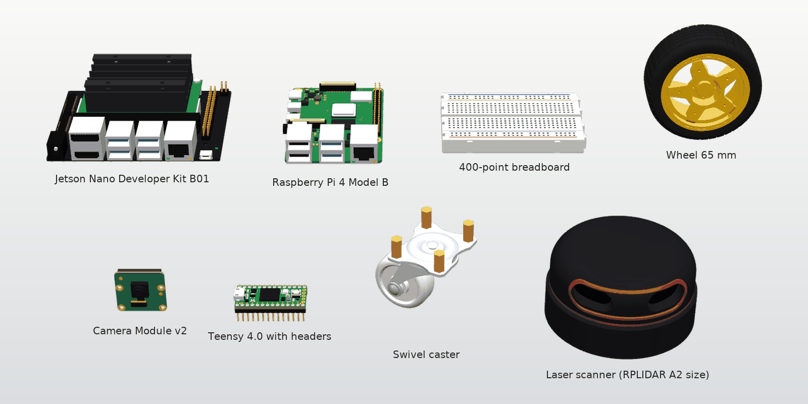
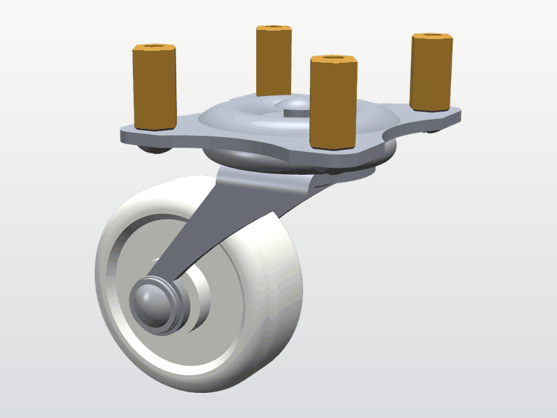
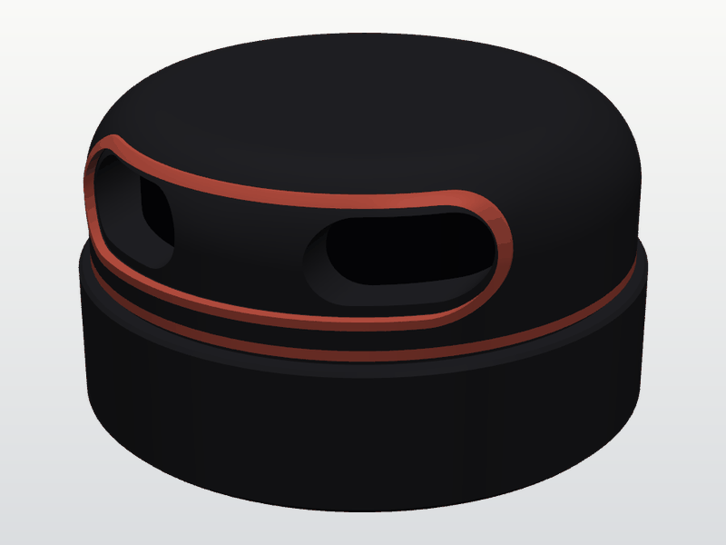
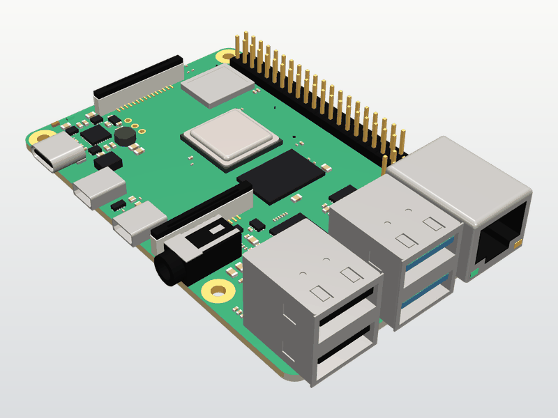
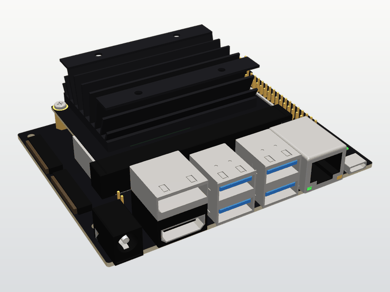
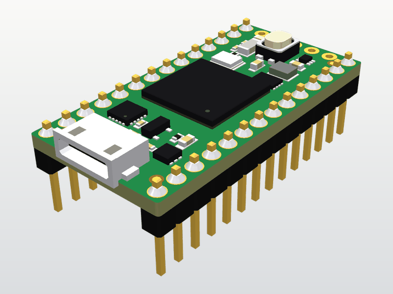
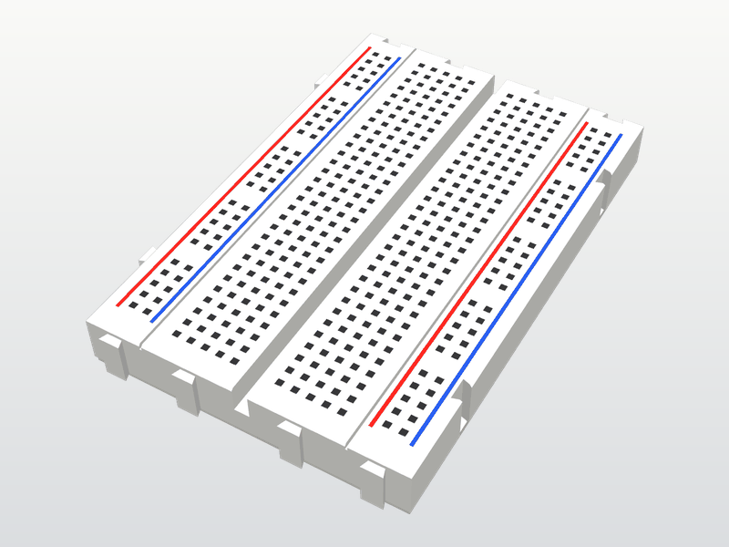
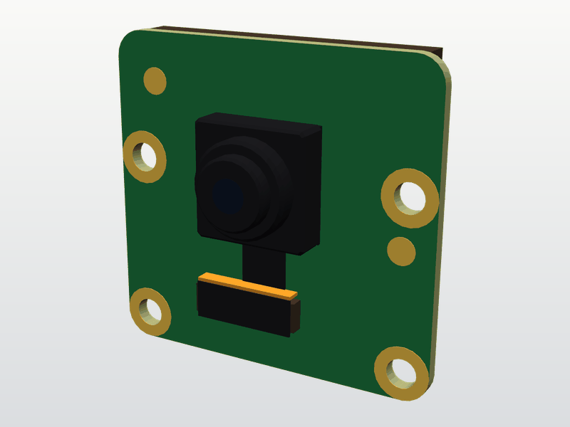

<!-- SPDX-FileCopyrightText: 2026 ROS Mobile Robots
     SPDX-License-Identifier: BSD-3-Clause -->
# robot_component_models

Display models of off-the-shelf robot components, such as a laser scanner, single-board computers and a caster, for ROS 1 (Noetic) and ROS 2 (Humble and later), made for the [DiffBot and Remo](https://ros-mobile-robots.com) robots. Every model is generated by a script with [CadQuery](https://cadquery.readthedocs.io/), a Python library for solid models, from the dimensions in datasheets, drawings and photos. The generator and the sources of every model are in this repository, under the [license](#license) below.



These are display models for visualisation in RViz, Gazebo and web viewers. They aren't manufacturing designs. Robot assembly, joints, collision shapes and inertias belong in each robot's description package.

## Parts

| Part | Picture | Meshes | Used by | Triangles | STL / DAE / GLB |
|---|---|---|---|---|---|
| [Swivel caster with a 30 mm wheel](provenance/swivel_caster_30mm.md) |  | `swivel_caster_30mm/swivel_caster_30mm_base`<br>`swivel_caster_30mm/swivel_caster_30mm_wheel_support`<br>`swivel_caster_30mm/swivel_caster_30mm_wheel` | DiffBot | 9,820<br>6,592<br>5,572 | 491 / 499 / 232 kB<br>330 / 337 / 153 kB<br>279 / 272 / 121 kB |
| [360 degree laser scanner, RPLIDAR A2 size](provenance/rplidar_a2.md) |  | `rplidar_a2/rplidar_a2` | DiffBot, Remo | 13,014 | 651 / 718 / 332 kB |
| [Raspberry Pi 4 Model B](provenance/raspberry_pi_4b.md) |  | `raspberry_pi_4b/raspberry_pi_4b` | Remo | 15,116 | 756 / 1,001 / 594 kB |
| [Jetson Nano Developer Kit B01](provenance/jetson_nano_dev_kit_b01.md) |  | `jetson_nano_dev_kit_b01/jetson_nano_dev_kit_b01` | Remo | 5,696 | 285 / 396 / 252 kB |
| [Teensy 4.0 with two 14-pin headers](provenance/teensy_4_0.md) |  | `teensy_4_0/teensy_4_0` | Remo | 25,520 | 1,276 / 1,654 / 900 kB |
| [400-point solderless breadboard](provenance/breadboard_400_point.md) |  | `breadboard_400_point/breadboard_400_point` | Remo | 6,768 | 338 / 428 / 290 kB |
| [Raspberry Pi Camera Module v2](provenance/raspberry_pi_camera_v2.md) |  | `raspberry_pi_camera_v2/raspberry_pi_camera_v2` | Remo | 2,976 | 149 / 209 / 116 kB |
| Wheel 65 × 25 mm | Planned | `wheel/…` | DiffBot, Remo | | |

Each mesh comes in three files in `meshes/<part>/`, all in metres:

- `<name>.dae`: COLLADA 1.4.1, Z up, with coloured materials and one node per sub-part.
- `<name>.stl`: binary STL, without colours.
- `<name>.glb`: binary glTF 2.0 with the same materials, for web viewers. The COLLADA colours are sRGB values, as viewers show them, and the glTF base colours are the same colours as linear values, as glTF defines them. Metal parts are metallic, and the roughness follows from the COLLADA shininess. Each sub-part, such as a connector, is a named node, so a viewer can move the sub-parts apart.

[`meshes/manifest.yaml`](meshes/manifest.yaml) lists every file with its checksum, size, units, frame, bounding box, triangle count, sub-parts and materials. The provenance page of each part, linked in the table, lists its sources, shows its frame in a picture, and says what was estimated or simplified and which measurements would improve it.

## Adding the package to a workspace

The package installs only data: `meshes/` with the manifest, `provenance/` with the sources of each part, and `LICENSE`. It builds with catkin under ROS 1 and with ament_cmake under ROS 2. CadQuery isn't needed to build or use it. The installed provenance pages link to their generators and pictures in this repository, at the tag of the installed version.

1. Declare the dependency in the `package.xml` of the package that uses the meshes:

   ```xml
   <exec_depend>robot_component_models</exec_depend>
   ```

2. Add the repository to the workspace. For example, with [vcstool](https://github.com/dirk-thomas/vcstool), add this to the workspace's `.repos` file:

   ```yaml
   repositories:
     robot_component_models:
       type: git
       url: https://github.com/ros-mobile-robots/robot_component_models.git
       version: main
   ```

   Releases are tagged with their version, such as `1.0.0`. No release is tagged yet, so the example follows `main`. Pin a release's tag as the `version` once one exists: a released file keeps its frame (see [Versioning](#versioning)).

3. Import, build and source the workspace. In ROS 1 Noetic:

   ```bash
   cd ~/catkin_ws && vcs import src < my_robot.repos
   catkin build robot_component_models
   source devel/setup.bash
   ```

   In ROS 2:

   ```bash
   cd ~/ros2_ws && vcs import src < my_robot.repos
   colcon build --packages-up-to robot_component_models
   source install/setup.bash
   ```

4. Check that ROS finds the package and that the laser scanner's COLLADA file is there. In ROS 1:

   ```bash
   ls "$(rospack find robot_component_models)/meshes/rplidar_a2/rplidar_a2.dae"
   ```

   In ROS 2:

   ```bash
   ls "$(ros2 pkg prefix --share robot_component_models)/meshes/rplidar_a2/rplidar_a2.dae"
   ```

   Each command prints the file's path. The next section shows this file in a URDF.

`vcs import --skip-existing` doesn't move an existing checkout to a new tag. To update one, run `git fetch --tags && git checkout <tag>` in `src/robot_component_models`.

## Using the meshes in a URDF

A URDF refers to a file as `package://robot_component_models/meshes/<part>/<file>`. Each mesh has its own frame. Its origin and axes are in the manifest and in the Frame section of its provenance page, which starts with a picture of the frame. The robot description supplies the transform that places the mesh.

### Choosing the file

| File | Use | In the URDF |
|---|---|---|
| `<name>.dae`, COLLADA | Coloured visuals, in ROS 1 and in ROS 2. The file brings its own colours. | Leave out the scale. Leave out material overrides, the visual's `<material>` and the link's Gazebo `<material>`, to keep the mesh's colours across viewers. |
| `<name>.stl` | A visual in one colour. | Leave out the scale: the file is in metres. The colour comes from the visual's `<material>`. |
| `<name>.glb`, binary glTF | Web viewers. glTF defines y as up, and the file's root node turns the mesh into that scene. | Use the COLLADA file in a URDF. RViz 2 and Gazebo (gz-sim) in ROS 2 Jazzy show a part from its glTF file turned by 90° about x against its COLLADA file, and gz-sim drew the metal materials dark in the one scene that was tried ([issue #14](https://github.com/ros-mobile-robots/robot_component_models/issues/14)). RViz in ROS 1, Gazebo Classic and Gazebo Fortress don't load `.glb` files. |

### Placing a mesh

The visual's `<origin>` places the mesh's frame in the link's frame. The laser scanner's frame has its origin on the rotation axis, in the laser band, 29.85 mm above the scanner's bottom (see its [Frame section](provenance/rplidar_a2.md#frame)).

A link whose frame is the mesh's frame shows the mesh without an offset:

```xml
<link name="scanner_link">
  <visual>
    <geometry>
      <mesh filename="package://robot_component_models/meshes/rplidar_a2/rplidar_a2.dae"/>
    </geometry>
  </visual>
</link>
```

A link whose origin lies at the scanner's bottom, with the same axes, raises the mesh by 29.85 mm. The scanner's bottom then sits at the link's origin:

```xml
<link name="scanner_mount">
  <visual>
    <origin xyz="0 0 0.02985" rpy="0 0 0"/>
    <geometry>
      <mesh filename="package://robot_component_models/meshes/rplidar_a2/rplidar_a2.dae"/>
    </geometry>
  </visual>
</link>
```

The STL file takes its colour from the URDF. The visual defines the colour itself, so the example needs no material elsewhere in the robot description:

```xml
<link name="scanner_mount">
  <visual>
    <origin xyz="0 0 0.02985" rpy="0 0 0"/>
    <geometry>
      <mesh filename="package://robot_component_models/meshes/rplidar_a2/rplidar_a2.stl"/>
    </geometry>
    <material name="dark_grey">
      <color rgba="0.2 0.2 0.2 1"/>
    </material>
  </visual>
</link>
```

A visual's `rpy` turns the mesh. DiffBot's and Remo's laser links have the scanner's cable at their +x, where the mesh has it at -x, so their visuals turn the mesh by π about z (see the [Frame section](provenance/rplidar_a2.md#frame)).

Keep the collision shapes and inertias in the robot description, for example as boxes and cylinders.

### Gazebo (gz-sim): the resource path

RViz, RViz 2 and Gazebo Classic find `package://robot_component_models/...` through ROS. The newer Gazebo, gz-sim, looks for a folder named `robot_component_models` in the folders of its resource path. The package doesn't add itself to that path yet ([issue #13](https://github.com/ros-mobile-robots/robot_component_models/issues/13)). Until it does, add the folder that holds the installed package before Gazebo starts:

```bash
export GZ_SIM_RESOURCE_PATH="$(dirname "$(ros2 pkg prefix --share robot_component_models)")${GZ_SIM_RESOURCE_PATH:+:$GZ_SIM_RESOURCE_PATH}"
```

Without the path, gz-sim spawns the robot, logs `Unable to find file with URI [model://robot_component_models/...]` and draws no mesh. This was seen with ROS 2 Jazzy and Gazebo Harmonic (gz-sim 8.15.0), with a test package that is installed like this one. Gazebo Fortress, the Gazebo of ROS 2 Humble, names the variable `IGN_GAZEBO_RESOURCE_PATH`.

### Tested so far

- **ROS 1 Noetic, RViz and Gazebo Classic 11:** the COLLADA and STL files in DiffBot's and Remo's descriptions.
- **ROS 2 Humble:** CI checks the package's build and install.
- **ROS 2 Jazzy, RViz 2 and gz-sim:** the glTF files, with the result in the table above. RViz 2 and gz-sim haven't rendered the COLLADA and STL files in a test yet.

## Mesh conventions

### Units

All files are in metres, ROS's unit for lengths ([REP 103](https://www.ros.org/reps/rep-0103.html)). STL has no unit field, and ROS reads its coordinates as metres, so no file needs a scale. The generators build the models in millimetres and convert the coordinates when they write the files. The provenance pages give positions in millimetres.

### Frames

Each mesh has its own local frame, Z up. The origin isn't always the part's centre, and the axes follow each part. For example:

- [Raspberry Pi 4 Model B](provenance/raspberry_pi_4b.md#frame): z = 0 at the board's mid-plane.
- [Jetson Nano Developer Kit](provenance/jetson_nano_dev_kit_b01.md#frame) and [Teensy 4.0](provenance/teensy_4_0.md#frame): z = 0 at the board's bottom face.
- [Laser scanner](provenance/rplidar_a2.md#frame): the rotation axis along z, the bottom at z = -29.85 mm, the optical window's centre at z = +0.95 mm.
- [Camera Module v2](provenance/raspberry_pi_camera_v2.md#frame): the board in the yz plane, the lens looking along +x.
- [Swivel caster](provenance/swivel_caster_30mm.md#frames): the base's swivel axis at x = -1 mm, the fork's axle along y at x = -16 mm, z = -20 mm.

Every mesh's frame is described in the manifest (`frame`) and in the Frame section of its provenance page. That section starts with a picture of the frame: the origin, the positive axes, a ring around each mounting hole and a line at the mounting plane. The manifest's bounding boxes are in this local frame.

The glTF files use the same local frame for their vertex data. Their root node turns the data by -90° about x into glTF's Y-up scene. The manifest's glTF bounding boxes are those of the vertex data, before this root rotation.

### File names

Names are lowercase snake_case and name the product. A part's folder, generator module, provenance page and picture share one identifier, for example `rplidar_a2`. A part with one mesh uses that identifier as the file stem: `meshes/rplidar_a2/rplidar_a2.stl`. A part with several meshes adds each mesh's role: `swivel_caster_30mm_base`, `swivel_caster_30mm_wheel_support` and `swivel_caster_30mm_wheel`. A further design of the same kind gets its own qualifier, for example a different caster.

### Versioning

A released file keeps its frame, units and attachment points. A change that moves the origin, turns the axes, changes the units or moves an attachment point, such as mounting holes or an axle, gets a **new file name**. The old file stays, so robots that use it don't change. A change that keeps all of these keeps the file name, even if the bounding box grows with a finer detail. The manifest then shows the new checksum and bounding box.

The version follows [Semantic Versioning](https://semver.org): the first number rises when a file is removed or renamed, the second when files are added or changed, the third for fixes that leave the meshes as they are.

## Regenerating the meshes

The generators are Python scripts, one per part, in [`generators/`](generators/). They use [CadQuery](https://github.com/CadQuery/cadquery) and its OCP bindings to OpenCASCADE. Each has its parameters at the top, with the source of each value. [`generators/mesh_export.py`](generators/mesh_export.py) writes the three file formats for all of them. CadQuery is needed only to regenerate the files, not to build or use the package.

CI regenerates the files byte for byte in its generator environment: the Ubuntu 24.04 image, pinned by its digest, with Python 3.12.3 and glibc 2.39, and the Python packages of [`generators/requirements.txt`](generators/requirements.txt), pinned to exact versions. The Ubuntu packages that CI installs with apt aren't pinned. Other versions of CadQuery, OCP or NumPy, or another operating system, can triangulate differently. The meshes are then still valid, but their checksums change.

So check the released files, and write them, in that environment. [The generator environment in a container](CONTRIBUTING.md#the-generator-environment-in-a-container) in the contributor guide builds it once and then runs the check, which only reads `meshes/`.

For the work on a model, a virtual environment on the host is quicker. From the repository's root:

```bash
python3 -m venv .venv && .venv/bin/pip install -r generators/requirements.txt
.venv/bin/python -m generators --check          # regenerate into a temporary folder, compare with meshes/
.venv/bin/python -m generators rplidar_a2       # write one part's meshes
.venv/bin/python -m generators                  # write all meshes and meshes/manifest.yaml
.venv/bin/python scripts/check_meshes.py        # read the files back, check them against the manifest
.venv/bin/python -m unittest discover -s tests  # the unit tests of the generators and the checks
.venv/bin/python scripts/render_parts.py        # render the pictures in docs/images/
.venv/bin/python -m scripts.render_frames       # render the frame pictures in docs/images/frames/
```

`--check` only reads `meshes/`. With `--check --keep DIR`, the regenerated files stay in the new folder `DIR`, outside `meshes/`, for a closer look.

The models are written with CadQuery because its models are plain Python driven by the dimensions from the sources, built on the OpenCASCADE solid modelling kernel. A change to a model is a readable diff of parameters and code, the generators need no graphical CAD program, and CI regenerates and checks every file. [build123d](https://build123d.readthedocs.io/) is the closest alternative, also a Python library on OpenCASCADE.

## Checks

[CI](.github/workflows/ci.yml) runs on every pull request:

1. **Regeneration**: regenerates all parts twice in the generator environment, each time into a new folder, and fails if any file differs from the manifest's checksum. The check only reads `meshes/`.
2. **Mesh checks**: every STL is closed and consistently oriented. Triangle counts, units and bounding boxes match the manifest. Each COLLADA and glTF file holds the triangles of its STL file, with the same winding. The COLLADA files are valid against the COLLADA 1.4.1 schema and load in pycollada. The glTF files load in trimesh and pass the Khronos glTF Validator. The job also runs the unit tests in [`tests/`](tests/): the generators' command line, the grouping of a model's pieces by material, the comparison of the three formats, and that every part is registered for its pictures, its provenance page and the README.
3. **ROS packages**: builds and installs the package in the `ros:noetic` and `ros:humble` containers and checks that the installed `share/robot_component_models` holds exactly the manifest's files, their license files, the manifest, the provenance pages, `LICENSE`, `package.xml` and the build tools' own files, and that the installed provenance pages link to this repository at the installed version's tag. The ROS 1 build is checked with `catkin_make_isolated` and with colcon.
4. **Code style**: flake8 with ROS 2's ament_flake8 settings and mypy, which requires type hints on every function, on the generators, scripts and tests.

## Related work

Other collections model similar parts:

- [cq-electronics](https://cq-electronics.readthedocs.io/): electronic boards and components, such as a Raspberry Pi 3B, pin headers and RJ45 jacks, as CadQuery code.
- KiCad's [3D model libraries](https://gitlab.com/kicad/libraries/kicad-packages3D) and [KiCad Library Tools](https://gitlab.com/kicad/libraries/kicad-library-tools): models of a very large range of electronic components, and the scripts that generate them.
- [Adafruit_CAD_Parts](https://github.com/adafruit/Adafruit_CAD_Parts): Adafruit's boards and parts as STEP, Fusion 360 and STL files.
- [NopSCADlib](https://github.com/nophead/NopSCADlib): an OpenSCAD library of bought parts, such as motors, bearings, boards and cameras.

## Contributing

Corrections from measurements of the real parts are welcome. See [CONTRIBUTING.md](CONTRIBUTING.md).

## License

Everything in this repository is under the [BSD 3-Clause License](LICENSE), Copyright (c) 2026, ROS Mobile Robots: the CadQuery designs and generators, the generated STL, COLLADA and glTF files, the scripts, the ROS packaging and the documentation. Text files carry the license as SPDX lines in their header. The STL and glTF files, which are binary, carry it in a `<file>.license` next to them. When you redistribute the meshes, retain the copyright notice, the license conditions and the disclaimer. Including this repository's `LICENSE` with the distribution does that. The installed package includes it, and also each part's provenance page.

*Optional:* if you show or share these models, a credit is appreciated, but not required: "Models by ROS Mobile Robots, [robot_component_models](https://github.com/ros-mobile-robots/robot_component_models)".

Product names such as Raspberry Pi, Jetson, Teensy and RPLIDAR identify the products these models show. They are trademarks of their owners, and the models carry no logos or brand marks.
