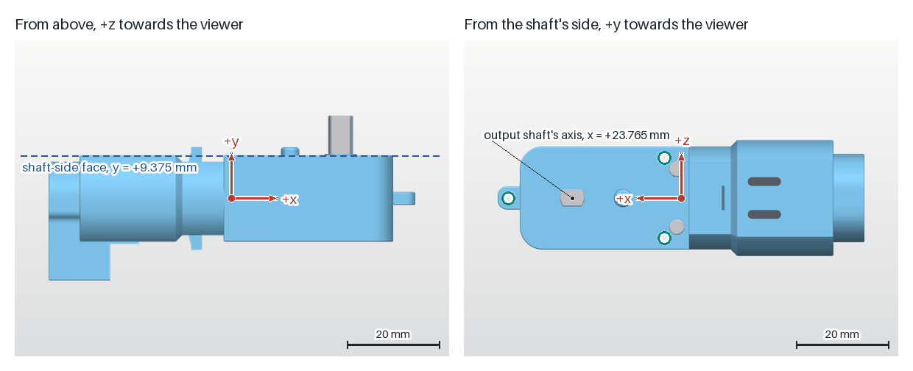

<!-- SPDX-FileCopyrightText: 2026 ROS Mobile Robots
     SPDX-License-Identifier: BSD-3-Clause -->
# Gear motor with hall encoder, DG01D-E size

A DG01D-E gear motor with its hall encoder. This light blue motor drives DiffBot's and Remo's wheels.

The model shows the gearbox with the output shaft and a mounting tab, the round motor housing with two vents in each of its two flats, the round neck, and the D-shaped encoder cover at the motor's end with the six-pin connector in a window. It uses the dimensions of SparkFun's drawing DS-16413, measurements of the motor made for Remo's design, values measured on a motor with a caliper, and the look of SparkFun's product photos, listed under [Sources](#sources). It shows no logos and no printed text.

Generator: [`generators/dg01d_e_gearmotor.py`](../generators/dg01d_e_gearmotor.py).

## Frame



The picture shows the motor from above and from the shaft's side. The red dot is the origin of the mesh's frame, in the gearbox's two middle planes, and the red arrows are its positive axes. The green rings mark the two Ø3.08 mm mounting holes through the gearbox and the tab's Ø2.99 mm hole. The dashed line in the left view is the gearbox's shaft-side face. The label in the right view names the output shaft's axis.

The files are in metres. Positions on this page are in millimetres.

| What | Place in the mesh's frame |
|---|---|
| Ends | The encoder cover's end at x = -39.725 mm, the tab's end at x = +39.975 mm. The drawing's overall length of 79.95 mm sets the origin. On the motor measured with a caliper, the encoder cover ends 74.90 mm from the gearbox's end, 0.25 mm closer than in the drawing |
| Output shaft | Its axis along y at (x, z) = (23.765, 0) mm. The shaft stands out of the shaft-side face to y = +18.025 mm |
| Gearbox's faces | The shaft-side face at y = +9.375 mm, the other face at y = -9.375 mm, the top and bottom at z = ±11.2 mm |
| Mounting holes | Two holes of Ø3.08 mm along y, through the gearbox, at (x, z) = (3.765, 8.7) and (3.765, -8.7) mm |
| Tab's hole | Ø2.99 mm along y, at (x, z) = (37.575, 0) mm, in a tab from y = -1.4 to +1.4 mm |
| Boss on the shaft's side | Ø3.98 mm at (x, z) = (12.765, 0) mm, 1.77 mm high, to y = +11.145 mm |
| Motor housing | From x = -32.975 to -10.675 mm, round with its axis along x at y = z = 0, up to z = ±12.6 mm: the highest and the lowest part of the motor |
| Encoder cover | From x = -39.725 to -26.345 mm, and its latch to x = -20.1 mm. Its connector side reaches y = -17.815 mm, where the connector's window opens |

+x points from the motor housing to the gearbox and the tab. +y points out of the gearbox's face that carries the shaft. +z completes the frame: across the gearbox's 22.4 mm height, up for the motor on DiffBot's and Remo's left side. The origin lies in the gearbox's middle planes y = 0 and z = 0, and halfway along the drawing's overall length.

### The robots' motor joints

Both robots fix a motor link to `chassis_link` on each side, with the shaft pointing outwards. The motor on the robot's left side (+y) keeps the mesh's axes. The motor on the right side is turned by π about x, so that its shaft points to -y and its encoder cover inwards. The joint poses come from each description's `motor.yaml` and its motor macro:

| Robot | Motor joint's position on `chassis_link` | Turn of the right motor |
|---|---|---|
| Remo ([remo_description](https://github.com/ros-mobile-robots/remo_description), `config/remo/motor.yaml`) | (0.012, ±0.04325, -0.0336) m | The joint's rpy (0, π, 0) and the visual's rpy (0, 0, -π) together turn the mesh by π about x |
| DiffBot ([diffbot](https://github.com/ros-mobile-robots/diffbot), `diffbot_description/config/diffbot/motor.yaml`) | (0.0015, ±0.03775, -0.017) m | The same turns as Remo's |

With Remo's motor joints, the mesh clears the mesh of Remo's chassis. The shaft and the boss reach into openings of the chassis' side wall, and the fin on the motor's outer side into a slot of the wall. Both mounting-hole patterns have 17.4 mm spacing. At these joint poses, corresponding hole axes are about 0.13 mm apart. Moved along one of its axes, the mesh touches the chassis after about 4.3 mm towards the robot's middle, and after 0.10 to 0.59 mm in each of the other five directions. These numbers come from the meshes, not from a printed chassis. The shaft's axis lies at x = 0.035765 m on `chassis_link`, 0.235 mm from Remo's wheel axle at x = 0.036 m, at the same height.

With DiffBot's motor joints, the shaft's axis lies at x = 0.025265 m on `chassis_link`, 6.765 mm in front of DiffBot's wheel axle at x = 0.0185 m. To put the shaft on the wheel's axis, DiffBot's motor visual needs an origin of x = -0.006765 m on the left motor and x = +0.006765 m on the right one, in the motor link's frame.

Neither robot's description uses this mesh yet.

### Attaching the motor in a URDF

The example uses the COLLADA file, which carries the model's colours. The file is in metres, so the mesh needs no scale. The STL file holds the same shape without colours. RViz draws it in the colour of the visual's `<material>`, and Gazebo Classic in the material of the link's `<gazebo>` element. The table [Choosing the file](https://github.com/ros-mobile-robots/robot_component_models/blob/c0c5a8c01b4fcec39ee8caee40f71c09745b910f/README.md#choosing-the-file) in the repository's README compares the three formats.

The example places both motors with Remo's joint positions. The right motor's joint turns the mesh by π about x:

```xml
<joint name="left_motor_joint" type="fixed">
  <parent link="chassis_link"/>
  <child link="left_motor"/>
  <origin xyz="0.012 0.04325 -0.0336" rpy="0 0 0"/>
</joint>
<link name="left_motor">
  <visual>
    <geometry>
      <mesh filename="package://robot_component_models/meshes/dg01d_e_gearmotor/dg01d_e_gearmotor.dae"/>
    </geometry>
  </visual>
</link>
<joint name="right_motor_joint" type="fixed">
  <parent link="chassis_link"/>
  <child link="right_motor"/>
  <origin xyz="0.012 -0.04325 -0.0336" rpy="3.14159265359 0 0"/>
</joint>
<link name="right_motor">
  <visual>
    <geometry>
      <mesh filename="package://robot_component_models/meshes/dg01d_e_gearmotor/dg01d_e_gearmotor.dae"/>
    </geometry>
  </visual>
</link>
```

## Mesh

`dg01d_e_gearmotor`: one mesh with eight sub-parts, each a named node for an exploded view.

| Sub-part | What | Materials |
|---|---|---|
| `gearbox` | The gearbox with its round end, the mounting tab, the boss and the ring around the shaft's foot. Two mounting holes, two recesses for the screws and small holes on the shaft's side, small holes and a shallow recess on the other side | `blue_plastic` (light blue) |
| `screws` | The heads of the two screws in their recesses on the shaft's side, with a cross recess | `steel` |
| `shaft` | The output shaft with two flats and a bore in its end | `steel` |
| `motor_housing` | The round motor housing with a flat on its +y and -y side and the chamfer to the neck, the round neck with a flat and a fin on each of these sides, two vents in each of the housing's flats | `blue_plastic` |
| `motor_can` | The motor's can at the bottom of the vents | `motor_can` (grey metal) |
| `encoder_cover` | The D-shaped cover at the motor's end: a round part on the shaft's side and a narrower box towards the other side, which holds the connector and reaches on under the motor housing. The connector's window in the box, and the latch next to the window, towards the gearbox | `blue_plastic` |
| `encoder_board` | The encoder board's part that shows in the window | `solder_mask_green` |
| `connector` | The six-pin header in the window, its six contacts and a row of six pin ends beside it | `white_plastic`, `tin` |

The metal materials are metallic in the glTF file. Each solid is closed and consistently oriented. Where two sub-parts meet, one reaches a little into the other, so that no two faces lie on each other.

## Sources

Primary source: SparkFun, *DG01D-E motor with encoder*, document DS-16413, page 1: the specification and two views with dimensions, a view of the shaft's side and a view along z. Page 2 gives the encoder board's size and its six terminals. SparkFun's product page links it as "Datasheet": <https://www.sparkfun.com/products/16413>, file <https://cdn.sparkfun.com/assets/8/3/b/e/4/DS-16413-DG01D-E_Motor_with_Encoder.pdf>. Values that the table marks "read off the scale" come from the drawing's image, at 6.2 pixels per mm, where the drawing gives no dimension.

Second source: measurements of the motor made for Remo's design, whose chassis holds the motor in a pocket with these sizes. The values were taken from the motor's geometry in that design, with sections through it and circle fits to its round features. The table marks these values "measured", the generator's parameter block "Remo".

Third source: a DG01D-E measured with a caliper. The table marks these values "caliper", as does the generator's parameter block. The shapes of the motor housing, the neck and the encoder cover follow this motor where the caliper gives no value. The table marks these values "the motor", the parameter block "motor". Where a caliper value differs by more than 0.2 mm from the drawing or from the measurements for Remo's design, the model uses the caliper value only if that takes material away, so that the motor keeps its place in Remo's chassis. [Caliper measurements](#caliper-measurements) lists every caliper value next to the model's.

| What | Value used | Where |
|---|---|---|
| Overall length | The drawing's 79.95 mm from the encoder cover's end to the tab's end sets the origin. The model's encoder cover ends 74.90 mm from the gearbox's end, 0.25 mm closer than the drawing's | DS-16413, upper view. The 74.90 mm: caliper |
| Gearbox | Its end 75.15 mm from the drawing's encoder end, at x = 35.175 mm. 18.75 mm thick (y), 22.40 mm high (z). The face towards the motor at x = -1.675 mm | DS-16413, both views. The face towards the motor: measured (the drawing's scale gives -1.66 mm) |
| Gearbox's round end | Two corners of R5 mm at the tab's end. The edges around the shaft-side face, the other face and the face towards the motor rounded by 0.3 mm | Measured (the drawing's scale gives R4.8 mm) |
| Boss | Ø3.98 mm, 1.77 mm high, at x = 12.765 mm, its top edge rounded by 0.7 mm. A small hole in its top | DS-16413: Ø3.98 and 1.77. Position and round: measured. The hole: SparkFun's photos, Ø0.8 mm and 0.5 mm deep, a choice |
| Output shaft | Ø5.40 mm, 3.70 mm across the flats, 8.65 mm past the gearbox's face, 11.00 mm from the boss's centre. A Ø1.8 mm bore in its end | DS-16413: Ø5.40, 3.70, 8.65 and 11.00. The bore: measured (the drawing's scale gives Ø1.8 mm), 6 mm deep, a choice |
| Ring around the shaft's foot | Ø7.0 mm, 0.3 mm high | DS-16413, read off the scale |
| Mounting holes | 2 × Ø3.08 mm, 9.00 mm from the boss's centre (x = 3.765 mm), at z = ±8.7 mm about the gearbox's middle plane, 17.4 mm apart | DS-16413: Ø3.08 and 9.00. z: measured. The drawing gives no dimension for z, and its scale reads about ±8.9 mm. The model uses ±8.7 mm: Remo's chassis has its two screw holes for the motor 17.4 mm apart |
| Tab | 5.00 mm high, 2.80 mm thick, Ø2.99 mm hole 24.81 mm from the boss's centre. Its end's corners R2 mm, its edges rounded by 0.3 mm | DS-16413: 5.00, 2.80, Ø2.99, 24.81. The rounds: measured |
| Tab's place across the gearbox | Centred on y = 0 | Measured. The drawing's scale puts it about 0.6 mm towards -y. The model keeps it centred, as Remo's chassis holds the tab |
| Motor housing | Round, Ø25.20 mm (z), cut by two flats 18.75 mm apart (y), whose edges lie at z = ±8.42 mm. From x = -32.975 mm, 22.30 mm long to the end of its 45° chamfer. The edges of its end at the encoder rounded by 0.3 mm | DS-16413: 25.20 and 22.30. Its upper view draws the flats' edges at about z = ±8 mm, read off the scale. The round sides: the motor, as SparkFun's photos show them too. The chamfer of 1.4 mm follows from the housing's and the neck's diameters. The rest: measured (the drawing's scale gives a start at -33.08 mm). The drawing's view along z puts the housing from y = +9.3 to -10.5 mm, read off the scale. The model keeps the measured 18.75 mm about y = 0, because the measured sections are symmetric |
| Neck | Round, Ø22.40 mm (z), as high as the gearbox, cut by two flats 15.95 mm apart (y) | The diameter: DS-16413, whose upper view runs the gearbox's lines on to the housing. The round sides: the motor. The flats' distance: measured. The drawing's view along z puts the neck's -y face flush with the gearbox's, read off the scale. The model keeps the measured, symmetric neck |
| Fins on the neck | One on each side: the face towards the gearbox 19.19 mm from the boss's centre (x = -6.425 mm), 2.90 mm long at the neck and 2.30 mm at the top, up to y = ±11.175 mm, 5.30 mm high (z). The face towards the motor housing slopes up to y = ±10.215 mm and rises straight from there | DS-16413: 19.19. The rest: measured (the drawing's scale gives about 3.1 and 2.2 mm long, 5.2 mm high). The drawing's view along z puts the fins' tops at y = +10.6 and -12.0 mm, read off the scale. The model keeps the measured, symmetric ±11.175 mm |
| Vents | On the shaft's side: two slots of 7.25 × 1.9 mm at x = -17.98 mm, z = ±3.57 mm. On the other side: two slots of 3.0 × 1.6 mm at x = -15.7 mm, z = ±3.6 mm. 1.2 mm deep with the motor's can at the bottom | Shaft's side: DS-16413, read off the scale. Other side: SparkFun's photo of that side. Depth: a choice |
| Screws on the shaft's side | Recesses of Ø4.7 mm at (x, z) = (1.07, ±6.29) mm, 1.5 mm deep. Pan heads of Ø3.4 mm, 0.5 mm below the face | DS-16413, read off the scale. Head: SparkFun's photo of the shaft's side. Depths: choices |
| Small holes | On the shaft's side: Ø1.4 mm at (x, z) = (16.83, ±9.78) and (32.74, ±8.45) mm. On the other side: Ø1.4 mm at (32.74, ±8.45) mm and Ø2.3 mm at (0.13, ±9.4) mm. 2 mm deep | Shaft's side: DS-16413, read off the scale. Other side: SparkFun's photo of that side. Depth: a choice |
| Recess on the side without the shaft | From x = -0.47 to 6.62 mm, z = ±6.05 mm, 0.3 mm deep, a Ø0.6 mm dot at (3.3, 0) mm | SparkFun's photo of that side. Depth and corners: choices |
| Encoder cover | A D across the motor's axis, 25.79 mm along y, from y = +7.975 to -17.815 mm, from the cover's end at x = -39.725 mm. Its round part on the shaft's side is 19.20 mm high (z). Its two corners there are rounded by 8 mm, with a flat strip of 3.2 mm between them, and its ±z faces end 10.5 mm from the +y face. From there an S-curve of two arcs, 3.0 mm along y, leads down to the box that holds the connector, 16.82 mm high (z). The box reaches on under the motor housing to x = -26.345 mm, 13.38 mm from the cover's end. The box's long edges on the -y side and the edges of the cover's end face are rounded by 0.3 mm | DS-16413: 25.79 and 19.20. Caliper: the box's 16.82 and 13.38 mm and the end's place (row "Overall length"). The +y face at +7.975 mm, flush with the neck's, and the 0.3 mm rounds: measured. The corners, the ±z faces' end and the S-curve: the motor |
| Connector's window | From x = -34.475 to -27.475 mm, z = ±7.6 mm, from the cover's face at y = -17.815 mm to y = -9.815 mm | Measured. The height: the motor, whose box keeps sides of about 0.8 mm beside the window |
| Encoder board and connector | The board 1.2 mm thick. A six-pin header, 14.8 mm long (z), 4.5 mm deep (x) and 6.0 mm high, its contacts 2.0 mm apart. A latch next to the window, towards the gearbox, from x = -26.845 to -20.1 mm, z = ±4.0 mm, 0.5 mm proud | DS-16413, page 2: the board's 1.2 mm and six terminals. The header's length, depth and place, and the latch's outline: SparkFun's photo of the connector's side. The header's height, the contacts' pitch (the photo reads about 2.1 mm) and the latch's 0.5 mm: choices |
| Look and colours | Light blue plastic for the gearbox, the housing and the cover, a metal shaft and screws, the motor's grey can behind the vents, a green board and a white connector | SparkFun's product photos of ROB-16413 on the product page |
| Choices | The shaft's bore 6 mm deep, its end chamfered by 0.2 mm. The screws' recesses 1.5 mm deep, their heads 0.5 mm below the face with a 0.3 mm round and a cross of two 2.0 × 0.5 mm slots, 0.5 mm deep. The small holes 2 mm deep. The recess on the side without the shaft 0.3 mm deep with 1 mm corners, its dot Ø0.6 mm and 0.5 mm deep. The vents 1.2 mm deep, the motor's can 1.0 mm below the face. The connector's walls 0.7 mm thick, its cavity 4.3 mm deep, the contacts 0.64 mm square with their ends 0.5 mm below the opening, the pin ends 0.6 mm square and 1.0 mm high. The parameter block holds the remaining choices, which don't show: how far the pieces reach into each other | Parameters at the top of the generator |

### Caliper measurements

The table lists the values measured on the motor with a caliper next to the model's values, in mm. The last column gives the drawing's value, or the value of the measurements for Remo's design where the drawing gives none.

| What the caliper measured | Caliper | Model | Drawing or Remo's design |
|---|---|---|---|
| From the encoder cover's end to the gearbox's end | 74.90 | 74.90 | 75.15 (drawing) |
| From the encoder cover's end to the tab's end | 79.80 | 79.70 | 79.95 (drawing) |
| The encoder cover along y | 25.78 | 25.79 | 25.79 (drawing) |
| The connector's box along z | 16.82 | 16.82 | 19.20 (Remo's design) |
| The connector's box along x, from the cover's end | 13.38 | 13.38 | 14.00 (Remo's design) |
| The motor housing along x, to the end of its chamfer | 22.29 | 22.30 | 22.30 (drawing) |
| From the encoder cover's end to the motor housing's chamfer, where the jaw rests on the chamfer | 28.89 | 27.65 to 29.05 along the chamfer | - |
| From the boss's centre, sighted, to the fins' faces towards the gearbox | 19.04 | 19.19 | 19.19 (drawing) |
| Across both fins (y) | 22.18 | 22.35 | 22.35 (Remo's design) |
| The gearbox along z | 22.35 | 22.40 | 22.40 (drawing) |
| The tab along z | 5.00 | 5.00 | 5.00 (drawing) |
| The tab's hole | Ø2.99 | Ø2.99 | Ø2.99 (drawing) |
| One of the mounting holes | Ø3.16 | Ø3.08 | Ø3.08 (drawing) |
| The boss | Ø3.93 | Ø3.98 | Ø3.98 (drawing) |
| The output shaft past the gearbox's face | 8.65 | 8.65 | 8.65 (drawing) |

Three values differ from the other sources by more than 0.2 mm: the length to the gearbox's end and the connector's box along z and along x. Each of them takes material away from the encoder cover, so the model uses the caliper's values. The tab keeps the drawing's 4.80 mm past the gearbox's end, so the model's length to the tab's end is 79.70 mm, 0.10 mm less than the caliper's.

## Simplified

- The gears, the motor and the bearings inside are left out. The motor's can shows only at the bottom of the vents.
- The encoder's magnet disc and most of its board are hidden under the cover on the real motor, and the model leaves them out. The board shows only in the connector's window.
- The six pin ends beside the connector stand on the board's visible strip inside the window. On the real motor they show in a narrow gap between the window and the latch.
- The lines where the halves of the gearbox, the motor housing and the encoder cover meet are left out, and so is a small nub on the motor housing next to the encoder cover.
- On the motor, the encoder board stands across the motor's axis, and the window shows the board's edge next to the connector. The model shows a strip of the board's face there.
- The small rounds at the fins' foot and top edges are left out.
- The drawing shows the output shaft on both sides of the gearbox. SparkFun's motor and the model have it on the shaft's side only.
- No cable and no plug in the connector.

## Measurements that would improve the model

1. The output shaft's diameter and the distance across its flats. The model uses the drawing's Ø5.40 and 3.70 mm.
2. The encoder cover's place across the motor: how far its face on the shaft's side lies from the gearbox's face on that side.
3. The features on the side without the shaft: the small holes, the recess and the vents, from a photo straight at that side with a ruler.
4. The connector: its pitch and size, and the latch's height.
5. The depths of the vents and the small holes.
