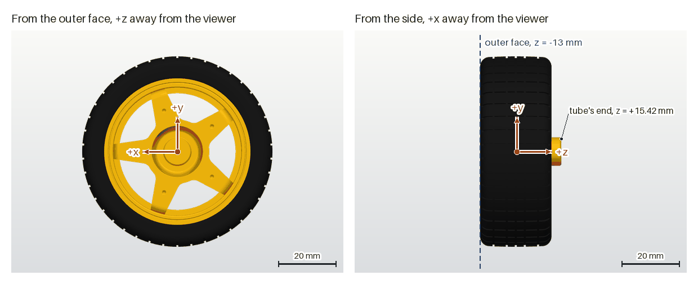

<!-- SPDX-FileCopyrightText: 2026 ROS Mobile Robots
     SPDX-License-Identifier: BSD-3-Clause -->
# Wheel 65 mm for TT gear motors

The common 65 mm wheel for TT gear motors: a yellow five-spoke plastic rim with a double-D bore and a black rubber tyre with a block tread. DiffBot and Remo drive on it. The model uses caliper measurements, estimates and photos of the real wheel, photos and video frames of the robots, product listings and shop photos, listed under [Sources](#sources).

Generator: [`generators/tt_motor_wheel_65mm.py`](../generators/tt_motor_wheel_65mm.py).

## Frame

The picture shows the wheel from its outer face and from the side. The red dot is the origin of the mesh's frame and the red arrows are its positive axes. The dashed line is the outer face at z = -13 mm, and the label marks the hub tube's end at z = +15.42 mm.

The files are in metres. Positions on this page are in millimetres. The axle runs along z at x = y = 0. The wheel's outer face is at z = -13 mm: the rim's outer flange face, flush with the tyre's sidewalls at their widest. The rim's motor-side flange face is at z = +12.00 mm, and the hub tube's end at z = +15.42 mm. Both robots turn the mesh so that +z points towards the robot.

In [DiffBot's description](https://github.com/ros-mobile-robots/diffbot/blob/noetic-devel/diffbot_description/urdf/include/common_macros.urdf.xacro) and [Remo's description](https://github.com/ros-mobile-robots/remo_description/blob/main/urdf/include/common_macros.urdf.xacro), the `wheel` macro's `front_left_wheel_joint` and `front_right_wheel_joint` attach `front_left_wheel` and `front_right_wheel` to `chassis_link`: on DiffBot at x = 18.5, y = ±69 and z = -17 mm, on Remo at x = 36, y = ±72 and z = -33.6 mm. The joint's origin is the axle's centre in the mesh's frame. The visual turns the mesh by 90° about x, and on the right side then by 180° about z, so +z points towards the robot on both sides. The wheel's outer face lies 13 mm outboard of the joint's origin, 0.5 mm beyond the URDF's 25 mm wheel cylinder.

The tyre's radius is 33.3 mm. The axle lies one URDF wheel radius above `base_footprint`. DiffBot's [`front_wheel.yaml`](https://github.com/ros-mobile-robots/diffbot/blob/noetic-devel/diffbot_description/config/diffbot/front_wheel.yaml) gives 33.3 mm, so the tyre touches the ground. Remo's [`front_wheel.yaml`](https://github.com/ros-mobile-robots/remo_description/blob/main/config/remo/front_wheel.yaml) gives 33.0 mm, so the tyre reaches 0.3 mm below the ground. Joints, collisions and inertias don't depend on the mesh. Nothing in the robots' descriptions refers to the motor-side end.

## Mesh

`tt_motor_wheel_65mm`: one mesh with two sub-parts, `rim` (material `rim`, yellow) and `tyre` (material `tyre`, black). Each is a closed solid, and they don't intersect. The STL file is closed and consistently oriented: two closed shells, with a modelling clearance of 0.02 mm where the tyre sits on the rim.

- **Barrel:** 25.00 mm wide, with a flange at each end (Ø51.22 mm), four grooves and three ridges between them (groove bottoms Ø47.91 mm), and seven axial ribs across the two middle grooves. The ridge next to the outer flange is Ø50.9 mm, the other two are Ø50.8 mm, and the ribs are as high as these two. The flanges' flat tops are 1.42 mm (outer) and 1.58 mm (motor side) wide. A groove's width at the top is given between its two walls, each wall continued straight to the level of the tops. From the outer flange towards the motor side: a rectangular groove 3.9 mm wide, a groove 5.8 mm wide at that level and 4.1 mm at the bottom with two sloped walls, a groove 4.8 mm wide at that level and 3.9 mm at the bottom whose wall on the outer-face side is vertical, and a rectangular groove 3.9 mm wide. The ridges' flat tops start 5.32, 12.4 and 18.5 mm from the outer face and are 1.20, 1.12 and 1.02 mm wide. Each flat top ends at the ridge's motor-side wall. On the outer-face side the first ridge's top edge is sharp. The other two ridges' top edges are rounded there: the flat top starts 0.08 and 0.18 mm behind the continued wall. So the finished openings between the flat tops are 3.90, 5.88, 4.98 and 3.90 mm. The flanges' outer corners are sharp, their inner corners round (0.5 mm).
- **Outer face:** the outer flange's face is flat and 3.2 mm high, with a fine groove in its middle. The groove is 0.7 mm wide at the face and 0.2 mm deep, and its bottom is 0.1 mm wide. Its side towards the tyre is a chamfer, its side towards the axle a round, and its two edges at the face are rounded. Inside the flange the barrel is Ø44.82 mm and plain for 3.5 mm. Then a lip 1.7 mm wide stands inward, to Ø40.8 mm. Behind the lip the barrel's inside is a cone: Ø44.6 mm at the lip, widening to Ø45.55 mm at the motor-side end.
- **Spokes and hub:** five flat spokes run outwards from the hub's flat face. Their face lies 1.0 mm behind the outer flange face. The spokes and the hub's face are one plate 1.7 mm thick, which passes in front of the lip. Each spoke's end comes down onto the lip in a round: a quarter circle of 2.5 mm from the flat face to the corner of the lip's front and the barrel's inside. From the lip's inner edge outwards the end is solid down to the lip, so the spoke stands on the lip. The spokes are symmetric about a radial centre line. Their straight sides taper from 8.0 mm near the hub to 5.8 mm above the lip's inner edge and 5.2 mm at their end. Curved blends widen them into the hub's face. Seen from outside, a spoke's sides meet the lip's inner edge in sharp corners. Each spoke has a round dimple, 7.4 mm before the spoke's end: a small bowl 0.6 mm deep with a rounded bottom and a rounded rim, Ø1.74 mm at the spoke's face. In the centre a bowl is recessed into the face. Its straight wall, continued, meets the face at Ø17.9 mm, the bowl's edge as read from the face-on photo. The edge in the face is rounded (0.2 mm), so the opening is Ø18.22 mm. Its wall runs straight down and turns into a flat floor with part of an ellipse whose semi-axes are 4.5 mm along the wall and 1.7 mm along the floor. The straight wall touches the ellipse, so the round spans 1.49 mm across and 2.31 mm along the axle. The floor is Ø13.8 mm, 5.0 mm below the face. Four pins stand on the floor, 6.3 mm from the axle, Ø1.2 mm and 1.45 mm high. Their feet end where the floor's round starts. The boss (Ø9.69 mm) stands on the floor, its top 3.0 mm below the face and 0.55 mm above the pins' tops. Behind the face the bowl's outside (Ø20.64 mm) shows through the windows. The spokes' back is flat. Behind each spoke stands a fin 1.51 mm thick, tall at the barrel and low at the hub. Its edge meets the barrel's inside 12.0 mm before the motor-side flange face and runs toward the axle. There it turns into a long straight edge down toward the hub, and before its bulge it turns toward the axle again. Both turns are rounds of 3.5 mm. The first round begins 17.36 mm from the axle, and the two straight pieces beside it, continued, meet 16.6 mm from the axle. The edge ends on its bulge, 19.3 mm before the hub tube's end.
- **Motor side:** the bowl's back is flat. This plate lies 21.22 mm before the hub tube's end. Its outer edge is rounded with a quarter ellipse, 2.585 mm along the plate and 4.5 mm along the bowl's outside (Ø20.64 mm), so the round starts at the spokes' back. The hub tube (Ø9.95 mm) stands on the plate. Around the tube's foot five bulges stand on the plate, one where each fin starts, with a notch between each two. Seen along the axle, the bulges and the notches form a smooth wave: a round on each bulge (3.0 mm) and a round the other way in each notch (0.35 mm). The bulges' tops lie on Ø15.27 mm and the notches' bottoms on Ø10.70 mm, 0.37 mm off the tube. A bulge is 3.47 mm wide 0.55 mm below its top. The plate's rounded edge starts 0.1 mm outside the circle of the bulges' tops. On a bulge's centre line its fin covers that strip. In a notch the plate is 2.39 mm wide, from the notch's wall to the rounded edge. The wave leaves the plate straight along the axle, with a sharp edge in each notch. Seen from the side, a bulge's top runs level from the plate. 20.16 mm before the tube's end it turns down with a round (1.6 mm) and runs into the tube with a round the other way (1.06 mm), which meets the tube's surface tangentially 17.5 mm before the tube's end. The end is the same all round the tube: a notch's wall runs straight along the axle to 18.31 mm before the tube's end, where the round into the tube falls below it, and that round takes it down to the tube. No flat ring is left around the tube. The double-D bore is Ø5.44 mm across the round sides, and the tube stands 3.42 mm past the flange.
- **Tyre:** Ø66.6 mm, a hollow section like a car tyre's. Its wall is 1.9 mm thick, and its inside follows its outside. The beads at its inner diameter (Ø50 mm) are 3.3 mm wide and 1.9 mm high. They sit inside the rim, each in the groove next to a flange, held there because the bead is smaller than the flange and the ridge. The sidewalls rise over the flanges and are widest about halfway up (Ø59.2 mm), flush with the flanges' faces, 25.00 mm across. The crown is a little narrower and slightly crowned. The tread has six block columns and 42 rows of blocks. The five grooves around the tyre lie in the middle and 3.15 and 7.8 mm to each side of it. All grooves are 0.7 mm wide and 0.6 mm deep, and the cross grooves reach down the sidewalls to a radius of 31.5 mm.

## Sources

| What | Source |
|---|---|
| Rim and tyre dimensions (the parameters marked pNN in the generator) | Measured on the part with calipers, the tyre taken off the rim, photos p01–p41 by the project (not published). Flange Ø51.22 (p01, p41: 51.25), groove bottoms Ø47.91 (p02), flange to flange 25.00 (p40), rim length 28.42 (p33), the bowl's outside behind the face Ø20.64 (p24) and its inside Ø17.62 near the spokes' face (p21), boss Ø9.69 (p23), spoke width 5.35 near its end (p25), a bulge at the hub tube's foot 3.47 wide (p18, p19), fin 1.51 (p31), hub tube Ø9.97 and Ø9.92 (p29, p30), 15.27 across the bulges (p15), bore Ø5.44 across the round sides (p14), bead to tread 8.38 and 8.82 (p07, p08) |
| The barrel's grooves, the outer flange's face, the barrel's inside, the hub's depths, the fins, the bulges at the hub tube's foot and the tyre's section (the parameters marked "measured" in the generator) | Measured on the same part with calipers by the project, without photos. The four grooves' widths at their tops and bottoms and their wall shapes. The flanges' flat tops (1.4 to 1.45 and 1.55 to 1.6 mm), the ridges' flat tops (1.0 mm or a little more), where the second and third start from the outer face (12.4 and about 18.5 mm), the ridges' diameters (Ø50.9 and Ø50.8 mm) and the first ridge's sharp top edge. The face's 3.2 mm, the fine groove's 0.7 mm at the face and 0.1 mm at its bottom, and its shape. 3.5 mm from the outer face to the lip, the lip's 1.7 mm and its inner diameter, Ø40.8 mm. The barrel's inside behind the lip: Ø44.6 mm near the lip and Ø45.55 mm near the motor-side end. The spokes' face 1.0 mm behind the outer flange face and the spokes' thickness, 1.7 mm. The spoke's width: 5.8 to 6.0 mm above the lip's inner edge and 5.2 mm where the spoke ends on the lip. The sharp corners where a spoke's sides meet the lip. The dimples: 7.4 mm before the spoke's end, closed, with a small round on the rim. The pins: Ø1.2 mm, about 1.45 mm high. Sharp outer and round inner corners on both flanges. The bowl's floor 5.0 mm and the boss's top 3.0 mm below the spokes' face. The spokes' flat back and the five fins: where a fin's edge meets the barrel (12.0 mm before the motor-side flange face) and its bulge (19.3 mm before the tube's end). The five bulges at the hub tube's foot: where they end at the tube (17.5 mm before its end). The tyre: its wall, about 1.9 mm everywhere, the beads' inner diameter (Ø50 mm), width (3.3 mm) and height (about 1.9 mm), where the tread's grooves around the tyre lie (in the middle and 3.15 and 7.8 mm to each side) and how far the cross grooves reach down the sidewalls (to a radius of 31.5 mm) |
| Estimated on the part (the parameters marked "estimated" in the generator) | Estimated on the same part by the project, without a caliper reading: the bowl's round into its floor (an ellipse's semi-axes, 1.7 mm along the floor and 4.5 mm along the wall), the pins' distance from the axle (6.3 mm), where the plate's rounded edge starts, 0.1 mm outside the circle of the bulges' tops, that edge's round along the bowl's outside (4.5 mm), the round on a bulge (3.0 mm), where a fin's edge turns near the barrel (16.6 mm from the axle) and the two rounds of a fin's edge (3.5 mm) |
| The notches' bottoms (the parameter marked "hub photo" in the generator) | A photo of the hub's motor side along the axle, by the project (not published), read with a camera fitted to the rim's outline in it: the notches' bottoms on r 5.2 to 5.5 mm |
| The tyre's section: hollow like a car tyre's, its inside following its outside, the beads inside the rim between the flanges, the sidewalls widest about halfway up and flush with the flanges, the crown a little narrower | The project's description of the real tyre, with photos p03–p09 |
| The ribs | The silhouette of side photo p37, scaled with the 25.00 mm flange to flange |
| The outer face's radii: the spokes' symmetry, the hub's flat face Ø22.4 mm, the bowl's visible edge Ø17.9 (the model's straight wall meets the face there, before the edge's round) and floor Ø13.8 mm, the pins' number and angle (four, one in line with a spoke), the dimples' width (Ø1.5 mm before the rim's round) and rounded bottom | Face-on photo p41, scaled with its own 51.25 mm reading. The spokes' taper was compared with this photo |
| The shape of each spoke's end: the spoke passes in front of the lip, and a round at its end brings it down onto the lip | A sketch of the section along a spoke and a close photo across the outer face, both by the project (not published) |
| The shapes of the fine groove, the tyre's inside, a fin's edge, the bulges and notches at the hub tube's foot, a bulge's side profile and the plate's rounded edge | Sketches of these sections by the project (not published) |
| Not measured: the number of the tread's block rows | The row pitch of about 5 mm on photos p07 and p08, so 42 rows around Ø66.6 mm. For comparison: video frames of DiffBot's wheel, taken by the project (not published), and the photo of Remo on ros-mobile-robots.com: [remo_front_side.jpg](https://ros-mobile-robots.com/resources/remo/remo_front_side.jpg) |
| Tyre outer diameter 66.6 mm | Measured on DiffBot: 66.3 and 66.8 mm, in DiffBot's [`front_wheel.yaml`](https://github.com/ros-mobile-robots/diffbot/blob/noetic-devel/diffbot_description/config/diffbot/front_wheel.yaml) |
| Bore flats 3.66 mm (not measured) | Product listings: [X2 Robotics, "Rubber Tire Wheel (Yellow 65mm)"](https://x2robotics.ca/wheels/rubber-tire-wheel-yellow-65mm) ("Hole Width Axis: 3.66 mm", "Long Shaft Hole: 5.3 mm") and [VXB](https://vxb.com/products/four-pack-68mm-tt-motor-hub-replacement-diy-kit-fo) ("hole 3.66mm × 5.3mm") |
| Comparison photos | X2 Robotics' product photos (link above) and [Otronic, "Wheel with rubber for robot or smart car, yellow"](https://otronic.nl/en/wheel-with-rubber-for-robot-or-smart-car-yellow.html) |
| Colours | remo_description's wheel colours: rim yellow `0.95 0.72 0.05`, tyre black `0.10 0.10 0.10` |

## Simplified or assumed

The Sources table names the values that are measured or estimated on the part or come from another source. The generator marks each value with its source: `estimated` for the values estimated on the part, the photo's number for a value read from a photo, `derived` for a value that follows from others, and `choice` for most of the values named as assumed below, which are neither measured nor estimated on the part. Where a value below comes from a photo or from the project's description of the real tyre, the generator names that source.

- **Held against the part:** four assumed values were held against the part and found right, without a reading: the round of the flanges' inner corners (0.5 mm), the dimples' depth (0.6 mm) and the tread grooves' width and depth (0.7 and 0.6 mm). The generator marks them `choice, fits the part`.
- **Construction values:** three `choice` values belong to how the model is built, and a part has nothing to measure for them. The tyre stands 0.02 mm off the rim, so that the two solids don't touch. The spokes' plate starts 9.6 mm from the axle, inside the bowl's wall. The pins reach 0.01 mm into the bowl's floor, so that the solids overlap.
- **Barrel, outside:** the measured groove widths (3.9, 5.8, 4.8 and 3.9 mm) are the widths between the walls continued to the tops' level. The first ridge's top edge on the outer-face side is sharp, so its flat top starts at its wall, 5.32 mm from the outer face (1.42 mm of flange top and 3.9 mm of groove), and is 1.20 mm wide. A measured 5.5 mm for that start doesn't fit the sharp edge, and the model doesn't use it. The flat tops of the other two ridges start where they were measured and end at the ridge's motor-side wall, so they are 1.12 and 1.02 mm wide (measured: 1.0 mm or a little more), and the top edge in front of each is rounded (0.08 and 0.18 mm). Assumed: the second groove's two walls slope the same, and the ribs' width (1.0 mm), height (as high as the two lower ridges) and length (from the middle of the first ridge to the middle of the third).
- **Outer flange face:** assumed are the fine groove's depth (0.2 mm), the angle of its chamfer (45°) and the rounds of its two edges (0.1 mm). The round on the groove's other side follows from these (0.32 mm). The face is 3.2 mm high and the fine groove 0.7 mm wide. Measured from each edge of the face to the groove: 1.3 mm. The three don't add up (3.3 mm). The model centres the groove, which leaves 1.25 mm on each side.
- **Barrel, inside:** the lip's inner diameter (Ø40.8 mm) and the barrel's inside in front of it (Ø44.82 mm) and behind it (Ø44.6 mm) give a lip that stands 2.01 mm inward at its front and 1.9 mm at its back. A measured 1.8 mm doesn't fit these diameters, and the model doesn't use it. Behind the lip the inside is a straight cone between the two measured diameters. Assumed: where the two diameters lie. Ø44.6 mm is placed at the lip's back, Ø45.55 mm where the round at the motor-side end begins, 0.49 mm before that end.
- **Spokes:** the round at each spoke's end is a quarter circle. Its radius, 2.5 mm, follows from the two measured depths: 3.5 mm to the lip minus 1.0 mm to the spokes' face. The radius itself isn't measured. The spokes' plate is 1.7 mm thick, so its back lies 0.8 mm in front of the lip's front. From the lip's inner edge outwards the model fills this gap under the spoke's end, so the spoke stands on the lip. The shape of this foot is assumed. The spoke's sides are straight lines through the two measured widths: 5.8 mm above the lip's inner edge (measured: 5.8 to 6.0 mm) and 5.2 mm at the spoke's end. They give 8.0 mm near the hub (r 13.2 mm) and 7.3, 6.8 and 6.2 mm at r 15.6, 17 and 19 mm. The 5.35 mm of photo p25 then lies at r 21.9 mm, on the round near the spoke's end. Assumed: the radius where a spoke's side curves into the hub's face (3.0 mm), and the dimples' shape, which is a straight wall that, continued, meets the spoke's face at Ø1.5 mm, a rounded bottom (0.3 mm) and a rounded rim (0.3 mm). The rim's round makes the dimple Ø1.74 mm at the face.
- **Bowl and boss:** the hub's flat face (Ø22.4 mm), the bowl's edge (Ø17.9 mm) and the bowl's floor (Ø13.8 mm) are read from the face-on photo and not measured with calipers. The model takes the bowl's edge as where the straight wall, continued, meets the face. The edge's round of 0.2 mm then makes the opening Ø18.22 mm. Estimated on the part: the bowl's round into its floor, part of an ellipse with semi-axes of 1.7 mm along the floor and 4.5 mm along the wall, and the pins' distance from the axle (6.3 mm). The bowl's straight wall touches that round 2.69 mm below the face, 1.49 mm outside the floor's edge. Photo p21 reads Ø17.62 mm near the spokes' face. The model reaches this diameter 0.67 mm below the face, and is Ø16.64 mm at the depth of the boss's top. The pins' number and angle (four pins, one in line with a spoke) are read from the face-on photo. Assumed: the chamfer at the boss's top (0.3 mm), the round at the boss's foot (0.3 mm), the round of the bowl's edge (0.2 mm), the thickness of the boss's closed top (0.8 mm) and the thickness of the bowl's floor (1.2 mm). The floor's thickness puts the plate 21.22 mm before the hub tube's end.
- **Fins:** a fin is 1.51 mm thick from its foot to its edge. Estimated on the part: where that edge turns near the barrel (16.6 mm from the axle) and the two rounds of the edge (3.5 mm). The edge turns by about 25° at each round, so a round of 3.5 mm lies only about 0.08 mm inside the sharp corner.
- **Motor side:** the bulges' tops lie on Ø15.27 mm. That value was read across the bulges. With five bulges no two tops lie opposite each other, and flat jaws across the model's bulges read 14.4 to 14.8 mm. If the 15.27 mm was read that way, the tops lie on Ø15.75 to Ø16.25 mm. Estimated on the part: the round on a bulge (3.0 mm), so a bulge is 3.47 mm wide 0.55 mm below its top. The round in a notch (0.35 mm) touches the rounds of the two bulges beside it and puts the notches' bottoms on Ø10.70 mm, the middle of the r 5.2 to 5.5 mm read on the photo of the hub's motor side. Where the plate's rounded edge starts, 0.1 mm outside the circle of the bulges' tops, and that edge's round along the bowl's outside (4.5 mm). 4.5 mm is the most the model builds there: the round then starts at the spokes' back. Along the plate that round follows from the bowl's outside (Ø20.64 mm), the plate's 0.1 mm and the tops' circle: 2.585 mm. Assumed: the round with which a bulge's level top turns down (1.6 mm). The round the other way into the tube follows from it and from the tube: 1.06 mm, so that it meets the tube's surface tangentially 17.5 mm before the tube's end. Also assumed: the chamfer at the tube's end (0.5 mm).
- **Bore:** the distance across the flats (3.66 mm) comes from product listings. Assumed: the flats face a spoke.
- **Tyre:** the tyre's width (flush with the flanges) and its sidewalls, widest about halfway up, follow the project's description, not a caliper reading. There the model takes Ø59.2 mm (halfway between the flange and the tread is Ø58.91 mm). The number of block rows (42) follows from a row pitch of about 5 mm on photos p07 and p08, not from a count. The video frames under Sources show the tread for comparison. Assumed: where a sidewall leaves the flange's top (0.4 mm behind the flange's face), the crown's width (18.6 mm) and drop (0.25 mm) and the round where a sidewall's inside meets the bead (0.5 mm). The sidewalls' inside is flat, so just above the beads the wall is 1.8 mm thick. A bead with Ø50 mm leaves 1.0 mm free above the groove's bottom (Ø47.91 mm), so the tyre rests on the flanges' tops only. The tyre's sidewalls and shoulders are quarter ellipses. The real tyre's inside has thin rings that the model leaves out.
- **Edges:** the flanges, ridges and ribs have flat faces and sharp edges, except the flanges' inner corners and the top edges of the second and third ridge on the outer-face side. The spokes' edges are sharp. The real edges are softer. The outer flange's face is flat. The real face has two slightly convex bands.

## Measurements that would improve the model

With calipers:

1. The tyre on the rim: its width at the sidewalls' widest point and over the tread, and the step from each flange's face to the sidewall (0 if flush). Whether the beads touch the grooves' bottoms.
2. The outer flange face: its height, the fine groove's width and depth, and the band on each side of the groove.
3. The distance from the outer face to the first ridge's top edge (5.3 or 5.5 mm).
4. The lip's inner diameter and how far it stands inward, at the same place.
5. The radius of the round at a spoke's end, with a radius gauge, or how far before the barrel's inside the spoke's flat face ends.
6. A spoke's width at two more places along the spoke. The barrel's inside diameter at two stated depths behind the lip.
7. The pins' distance from the axle, and whether one of them stands in line with a spoke. The bowl's diameter at two stated depths. The dimples' diameter at the spoke's face.
8. The hub's motor side: the distance from the hub tube's end to the plate, with the depth rod in a notch. The distance from a bulge's top to the far side of the hub tube, which gives the tops' circle. The plate's width in a notch, from the notch's wall to the plate's rounded edge. A bulge's rounds, the round where the bulges run into the tube, a notch's round and the round of the plate's edge, with a radius gauge.
9. The two rounds of a fin's edge, and how far from the axle the edge turns near the barrel.
10. The bore: the distance across its flats, which way they face, and its depth from the tube's end.
11. The four values that were held against the part: the round of the flanges' inner corners with a radius gauge, the dimples' depth, and the tread grooves' width and depth.
